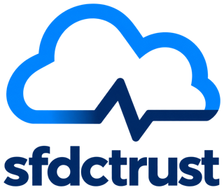

<p align="center">
    <picture>
        <source media="(prefers-color-scheme: dark)" srcset="https://raw.githubusercontent.com/jeffshurtliff/sfdctrust/main/docs/_static/logos-dark/sfdctrust-logo-dark-320.png">
        
    </picture>
</p>

# sfdctrust

An unofficial, community-maintained Python SDK project for the **Salesforce My Trust Center API**. 
It is not affiliated with or supported by Salesforce.

The synchronous and asynchronous clients list authorized tenants, retrieve
status snapshots, search events, and return event timelines and tenant history
through their detail operations.

The API exposes only tenants authorized by the caller's personal access token (PAT);
empty results do not establish Salesforce-wide health.

See the [API contract and implementation decisions](https://sfdctrust.readthedocs.io/en/stable/API_CONTRACT.html) 
for the verified operation inventory, schema notes, and authentication rules.

Review the [changelog](https://sfdctrust.readthedocs.io/en/latest/CHANGELOG.html) to see the changes associated 
with previous and upcoming releases.

## Quickstart

Install from PyPI with `python -m pip install sfdctrust` on Python 3.12 or later.
Set `SFDCTRUST_PAT` in the process environment using a PAT from My Trust Center.
For installation in a virtual environment, see [Installation](https://sfdctrust.readthedocs.io/en/stable/getting-started/installation.html).
For creating a PAT and entering it at a hidden prompt, see
[Prepare to use sfdctrust](https://sfdctrust.readthedocs.io/en/stable/getting-started/setup.html).

```python
from sfdctrust import TrustCenterClient

with TrustCenterClient.from_env() as client:
    for tenant in client.tenants.iter_all(page_size=50):
        print(tenant.id, tenant.name)
```

If you use `client.tenants.list()` to fetch a single page and `page.next_page_token`
is set, request the next page with
`client.tenants.list(page_token=page.next_page_token)` inside the same context.
If you supplied `page_size` or `locale` on the first call, repeat those values.
See the [quickstart](https://sfdctrust.readthedocs.io/en/stable/getting-started/quickstart.html) and
[tenant reference](https://sfdctrust.readthedocs.io/en/stable/reference/tenants.html) for details.

## Read-only CLI

Starting in 1.1.0, install `sfdctrust` from PyPI to use the `sfdctrust` command
or the equivalent `python -m sfdctrust` launcher.

```sh
sfdctrust --help
sfdctrust --version
sfdctrust tenants list --page-size 25 --json
sfdctrust tenants get synthetic-tenant --locale en-US
sfdctrust status snapshot --locale en-US --json
sfdctrust events search --tenant-id synthetic-tenant --start-time 2026-11-01T00:00:00Z --end-time 2026-11-02T00:00:00Z --event-type incident --json
sfdctrust events get synthetic-event --store-alias monitoring
sfdctrust tenants list --store-alias monitoring --page-token="" --json
```

Reads use `SFDCTRUST_PAT` by default. Explicit `--store`, `--store-path PATH`,
or `--store-alias ALIAS` selects an existing seeded SQLite store, ignores the
ambient PAT, and never falls back or initializes a file. Tenant listing and
event search retrieve one page. Keep every query input unchanged when continuing,
including tenant scopes, aware time bounds, and filters for search. Search requires
1–50 tenant IDs and full timezone-aware start/end timestamps, with start before
end. Optional repeatable event filters are `patch`, `incident`, `maintenance`,
and `informationalMessage`; omission includes all types. JSON preserves the
complete SDK response, including history/timeline, status groups, repeated scoped events, extras, and field
presence. Empty results describe the authorized scope and do not establish
Salesforce-wide health.

Root, group, and action help and root `--version` need no credentials or network. Invalid
arguments exit 2 before credential access, with empty stdout and a safe stderr
diagnostic. Long options must be written in full and read options follow the
action. See the [CLI guide](https://sfdctrust.readthedocs.io/en/stable/getting-started/cli.html)
for output, paging, credential selection, and exit codes.

The `python -m sfdctrust.pat_store init` command still initializes SQLite PAT stores.

## Local MCP server

Starting in 1.2.0, sfdctrust includes an optional local Model Context Protocol
(MCP) server. Install it from PyPI with `python -m pip install 'sfdctrust[mcp]'`.
Configure your local MCP host to launch `python -m sfdctrust.integrations.mcp`
using that environment's Python and supply `SFDCTRUST_PAT` in the server
process environment. The host can read authorized tenant details, status,
event search results, and timelines through five read-only tools.
See the [MCP setup and tool reference](https://sfdctrust.readthedocs.io/en/stable/getting-started/mcp.html)
for a host configuration, paging examples, output limits, and data visibility.

## Use the asynchronous client

```python
import asyncio

from sfdctrust import AsyncTrustCenterClient


async def main():
    async with AsyncTrustCenterClient.from_env() as client:
        snapshot = await client.status.snapshot()
        print('Ongoing incidents', len(snapshot.ongoing.incident))
        async for tenant in client.tenants.iter_all(page_size=50):
            print(tenant.id, tenant.name)


if __name__ == '__main__':
    asyncio.run(main())
```

Await single-page methods and the `list_all()` and `search_all()` collectors.
Consume `iter_all()` and `iter_search()` directly with `async for`.
Both clients use the same arguments, response models, and retry rules.
[Package reference](https://sfdctrust.readthedocs.io/en/stable/reference/package.html)

## Read status, search events, and inspect details

Use IDs from the tenant list, snapshot, or search results. Tenant detail
includes Salesforce's event history window. Event detail includes the
timeline when entries are available.

```python
from datetime import UTC, datetime, timedelta

from sfdctrust import TrustCenterClient
from sfdctrust.models.events import EventSearchScope

with TrustCenterClient.from_env() as client:
    snapshot = client.status.snapshot(locale='en-US')
    for incident in snapshot.ongoing.incident:
        print(incident.event_id, incident.title, list(incident.scope.tenants))

    tenants = client.tenants.list()
    if tenants.tenants:
        tenant_id = tenants.tenants[0].id
        end = datetime.now(UTC)
        results = client.events.search_all(
            scopes=[EventSearchScope(id=tenant_id)],
            start_time=end - timedelta(days=30),
            end_time=end,
            event_types=['incident'],
            page_size=50,
            locale='en-US',
        )

        if results:
            event = client.events.get(results[0].event_id, locale='en-US')
            for entry in event.timeline or []:
                print(entry.created_at, entry.sub_event_type, entry.message)

        tenant = client.tenants.get(tenant_id, locale='en-US')
        for event in tenant.events:
            print(event.event_id, event.status)
```

Use `client.tenants.list_all(page_size=50)` to collect tenants, or use
`client.events.iter_search(...)` with the same search arguments to consume
events lazily. Both traversals preserve order and duplicates. An empty page
continues when a cursor is present, including an empty string. A repeated cursor
or a required page beyond `max_pages` (default 1000) raises `PaginationError`
from `sfdctrust`. Iterators can yield items before a failure. Stale cursors raise
HTTP 400 `APIStatusError` without a restart.

All credential entry points default to two additional attempts per eligible read.
Set `max_retries=0` to disable SDK retries or choose an integer up to 5.

The search includes the start instant and excludes the end instant. Each
continuation repeats the original parameters and uses the token from the
preceding page. Salesforce's tenant history covers lifecycle overlap
within 365 days before or after the request time. Informational messages
cover the preceding 365 days. The PAT determines which tenants and events
are visible. An empty snapshot bucket, search page, or history establishes
no Salesforce-wide health claim.

See the [status and event reference](https://sfdctrust.readthedocs.io/en/stable/reference/events-and-status.html) 
for signatures and models.

## Rotate a PAT explicitly

For scripts on one computer, initialize the built-in SQLite store on a private,
encrypted local drive. Paste the first PAT at the hidden prompt:

```sh
python -m sfdctrust.pat_store init
```

```python
from sfdctrust import SQLitePATStore, TrustCenterClient

with TrustCenterClient.from_store(SQLitePATStore()) as client:
    result = client.refresh_pat(expires_in_days=7)
```

All jobs using that PAT must use the same database under the same OS account.
Keep it outside shared, network, and synced folders. The database contains the
PAT in readable form while the drive is unlocked. Custom durable adapters
remain supported for other storage systems.

Call `client.refresh_pat(expires_in_days=7)` to save and
activate a replacement. It sends one POST and returns a secret-free
`PATRefreshResult`. The constructor and `from_env()` remain static credential
modes. See the [authentication reference](https://sfdctrust.readthedocs.io/en/stable/reference/authentication.html)
for the adapter contract and recovery runbook. For setup, aliases, custom paths,
and environment-based initialization, 
follow [Prepare to use sfdctrust](https://sfdctrust.readthedocs.io/en/stable/getting-started/setup.html).

For asyncio, use `await AsyncTrustCenterClient.from_store(store)` with a
custom `AsyncPATStore`, then await rotation and any persistence recovery.
The built-in SQLite store currently supports the synchronous client.
[Async adapter contract and cancellation recovery](https://sfdctrust.readthedocs.io/en/stable/reference/authentication.html#async-store-backed-clients)

## Compatibility

The 1.x compatibility policy covers supported SDK imports and behavior, CLI
and MCP interfaces, and PAT-store upgrades. Per-attempt phase timeouts remain
fixed, including with injected HTTPX clients.
[Public compatibility and versioning policy](https://sfdctrust.readthedocs.io/en/stable/reference/compatibility.html)

## Development

Requires Python **3.12 or later** and Poetry **2.2 or later, below 3**.
From this checkout:

```sh
poetry install
poetry run pytest -q
poetry run ruff check .
poetry run ruff format --check .
poetry build
```

The SDK uses HTTPX and Pydantic v2. Tests run offline with synthetic PATs.

The [exception hierarchy](https://sfdctrust.readthedocs.io/en/stable/reference/exceptions.html) is available from `sfdctrust`, including
`ConfigurationError`, `AuthenticationError`, and the shared `TrustCenterError` base.
See [authentication](https://sfdctrust.readthedocs.io/en/stable/reference/authentication.html) for the implemented boundaries.

The documentation uses Sphinx with the optional `docs` dependency group:

```sh
poetry install --with docs
poetry run sphinx-build -W --keep-going -E -a -b html docs docs/_build/html
```

See [Maintain the documentation](https://sfdctrust.readthedocs.io/en/stable/maintainers/documentation.html) for details.
