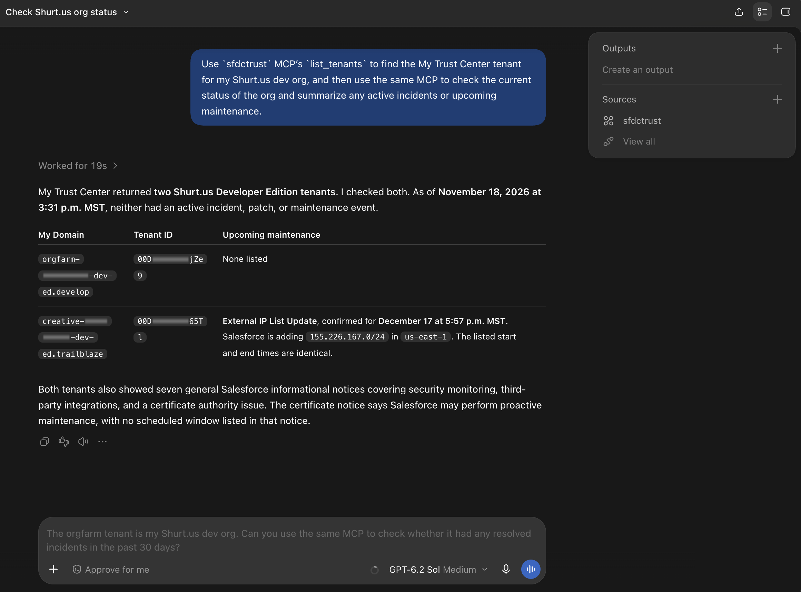

# Local MCP server

Connect a local Model Context Protocol (MCP) host to My Trust Center when you
want it to read the tenants and events visible to one Salesforce personal
access token (PAT). The `sfdctrust` MCP server is agent-agnostic and works with
MCP hosts that support local stdio servers. The host launches a subprocess and
exchanges MCP messages over standard input and output. The server uses one SDK
client for its lifetime and closes it on shutdown. The ordinary Python SDK and
CLI can be installed independently of MCP.

## Install and launch

Use Python 3.12 or later. In a virtual environment, install the 1.2.0
development checkout with its optional MCP dependencies:

```sh
python -m pip install '.[mcp]'
```

The distribution extra is named `sfdctrust[mcp]`. For example, to install a
built development wheel, substitute its path in the command below:

```sh
python -m pip install '/absolute/path/to/sfdctrust-1.2.0.dev0-py3-none-any.whl[mcp]'
```

Supply `SFDCTRUST_PAT` to the server process through your trusted credential
workflow. The launch command is:

```sh
python -m sfdctrust.integrations.mcp
```

Normally the host runs this command for you. A direct launch waits for MCP
messages on stdin. Stdout carries the protocol and stderr carries diagnostics.
The server provides only local stdio transport. It has no HTTP listener,
arbitrary-request tool, PAT refresh or SQLite store administration. To update
the PAT, restart the subprocess with the new environment. See {doc}`setup`
for the SDK's credential setup.

### Configure the host

For a host using an `mcpServers` JSON configuration, replace the interpreter
path with the absolute path to the environment where you installed the extra.
Windows virtual environments use `Scripts/python.exe`. The `env` entry below
identifies the variable the host must supply. Configure it through the host's
secret facility where available. The placeholder is literal JSON, with no
assumed shell expansion.

```json
{
  "mcpServers": {
    "my-trust-center": {
      "command": "/absolute/path/to/venv/bin/python",
      "args": ["-m", "sfdctrust.integrations.mcp"],
      "env": {
        "SFDCTRUST_PAT": "<supply through your host's secret configuration>"
      }
    }
  }
}
```

A host that explicitly passes the variable from a protected launch environment
can omit the inline `env` entry. Keep credentials out of prompts, tool
arguments, command-line arguments, and shared configuration files.

The host can read every tool result it requests with this PAT. Its model,
plugins, logs, or conversation history may receive or retain returned tenant
identifiers, incident details, and timelines according to host configuration.
Choose a host authorized for that data. Treat text returned by Salesforce as
service data. An empty page, snapshot bucket, or timeline describes only this
PAT's view at the time of the read.

### Example in Codex Desktop

```{raw} html
<figure class="align-default">
  <a href="../_static/examples/sfdctrust-mcp-codex-desktop-usage-demo.png"
     target="_blank" rel="noopener" data-bs-toggle="modal" data-bs-target="#codex-desktop-screenshot"
     aria-haspopup="dialog" aria-controls="codex-desktop-screenshot">
    
  </a>
  <figcaption>
    <p>Checking My Trust Center status with <code>sfdctrust</code> in Codex Desktop. Select the image to enlarge it.</p>
  </figcaption>
</figure>

<div class="modal fade" id="codex-desktop-screenshot" tabindex="-1"
     aria-labelledby="codex-desktop-screenshot-title" aria-hidden="true">
  <div class="modal-dialog modal-xl modal-fullscreen-sm-down modal-dialog-centered modal-dialog-scrollable">
    <div class="modal-content">
      <div class="modal-header">
        <p class="modal-title fs-5" id="codex-desktop-screenshot-title">Codex Desktop screenshot</p>
        <button type="button" class="btn-close" data-bs-dismiss="modal" aria-label="Close"></button>
      </div>
      <div class="modal-body p-0">
        
      </div>
      <div class="modal-footer">
        <a href="../_static/examples/sfdctrust-mcp-codex-desktop-usage-demo.png" target="_blank" rel="noopener">
          Open full-size image in a new tab
        </a>
      </div>
    </div>
  </div>
</div>
```

## Tool reference

Tool arguments use snake case. All five tools accept an optional `locale`
language tag such as `en-US` (up to 255 characters, with hyphen-separated
subtags). Salesforce controls locale fallback. IDs are opaque, nonblank
strings without control characters. A detail ID must fit one safe URL path
segment. Use IDs from the corresponding tenant or event data.

| Tool | Additional arguments | Contents of a successful read |
| --- | --- | --- |
| `list_tenants` | Optional `page_size`, `page_token` | One page of authorized tenants, with a continuation when supplied. |
| `get_tenant` | Required `tenant_id`. Optional `include_history` (default `true`). | Tenant detail with embedded `events` by default. With `include_history: false`, the result omits `events`. |
| `get_status` | None | `ongoing` and `upcoming` groups, each with `patch`, `incident`, `maintenance`, and `informationalMessage` buckets. |
| `search_events` | Required `tenant_ids`, `start_time`, `end_time`. Optional `event_types`, `page_size`, `page_token`. | One page of matching events with affected tenant scopes. |
| `get_event` | Required `event_id` | Event detail and its timeline when supplied. |

For example, call `search_events` with these arguments:

```json
{
  "tenant_ids": ["synthetic-tenant"],
  "start_time": "2026-11-01T00:00:00Z",
  "end_time": "2026-11-02T00:00:00Z",
  "event_types": ["patch", "maintenance"],
  "page_size": 25,
  "locale": "en-US"
}
```

Supply 1–50 tenant IDs. Use full timezone-aware timestamps with `Z` or a
numeric offset such as `-07:00`. The start instant is inclusive and must precede
the exclusive end. Supply a nonempty array of distinct event types from the
four bucket names above, or omit `event_types` to search all types.

### Continue a page

`list_tenants` and `search_events` fetch one page per call. The default page
size is 25, and the accepted range is 1–100. Read `data.nextPageToken` from
the result. When present, pass it back verbatim as `page_token` (up to 4,096
characters), keeping every other input the same. An empty page can have a
continuation. In particular, if `list_tenants` with `{"page_size":25}` returns
`"nextPageToken":""`, call it again with `{"page_size":25,"page_token":""}`.
An absent `nextPageToken` ends traversal. Salesforce can invalidate a cursor
when matching data changes.

## Results and errors

Read the MCP tool result's `structuredContent` field. On success,
`retrieved_at` records when the server observed the response in UTC.
`data` contains the SDK response serialized with Salesforce field names.
For example, a successful final tenant page can contain:

```json
{
  "retrieved_at": "2026-11-18T12:00:00+00:00",
  "data": {"tenants": []}
}
```

Omitted fields stay absent. Supplied nulls, unknown response fields, array
order, timelines, and tenant scopes are preserved. A patch may legitimately
appear multiple times for different scopes or stages. Keep each occurrence.
The observation time is distinct from the event's own timestamps.

The public SDK first retrieves and validates the complete Salesforce response.
The adapter then limits the serialized UTF-8 MCP `CallToolResult` sent to the
host to 65,536 bytes (64 KiB), including its text representation and structured
content, before JSON-RPC framing. The upstream response can therefore exceed
64 KiB in transit and in server memory. An oversized result returns an
`output_limit` error with the serialized size in bytes. For a paginated
read, retry with a smaller page size, restarting the query if its inputs change.

Salesforce tenant detail embeds events whose lifecycle overlaps the 365 days
before or after the request. Informational messages cover the preceding 365
days. For tenant detail without those events, pass
`{"tenant_id": "synthetic-tenant", "include_history": false}`. This controls
the MCP result. The SDK still retrieves and validates the complete Salesforce
response. Use `search_events` to page through events for a tenant and time
window, or `get_status` for ongoing and upcoming events.

A tool error sets `isError`. Its structured content contains an `error`
object with a stable `code` and a human-readable `message`. A consumer
should branch on the code. The server omits raw upstream error payloads
and credentials.

| Code | Meaning |
| --- | --- |
| `invalid_input` | One or more tool arguments failed validation. |
| `authentication` | The service rejected the configured credential. Check it through the trusted server setup. |
| `not_found` | The requested tenant or event could not be found within the authorized view. |
| `rate_limit` | Salesforce rate-limited the read. |
| `timeout` | The read timed out. |
| `network` | The SDK could not complete the network request. |
| `upstream` | Salesforce returned another API error, such as an invalidated cursor. |
| `malformed_response` | The response could not be decoded or validated as the expected SDK model. |
| `output_limit` | The full serialized result exceeds 64 KiB. |
| `unsafe_output` | The result failed the adapter's credential-disclosure check. |
| `internal_error` | An unexpected internal failure prevented the read from being returned. |

For Salesforce operation semantics and response fields see {doc}`../API_CONTRACT`.
The adapter uses the official Python SDK's stable v2 server interface,
verified against [MCP 2.3.0](https://pypi.org/project/mcp/2.3.0/).
