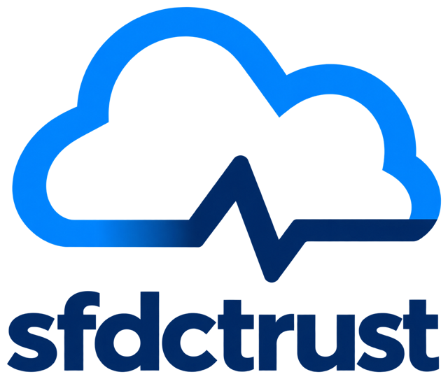
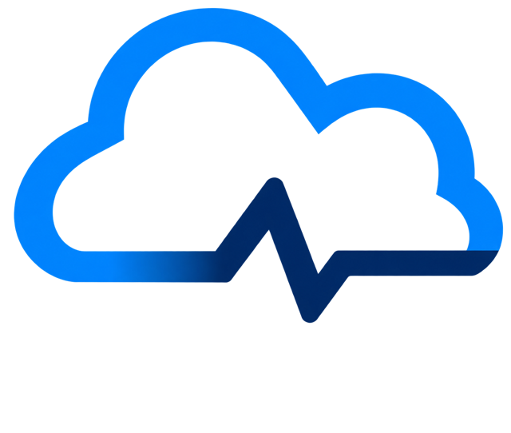

sfdctrust Documentation
=======================

``sfdctrust`` is an unofficial, community-maintained Python SDK for the
**Salesforce My Trust Center API**. It is not affiliated with or supported by
Salesforce.

.. warning::

   The project is in development. The synchronous client provides tenant
   listing, status snapshots, event search, and detail reads for events and tenants.

The API exposes only the tenants authorized by the caller's personal access
token (PAT). An empty or partial result does not establish Salesforce-wide health.

Documentation map
-----------------

* :doc:`getting-started/index`: project scope, requirements and installation.
* :doc:`reference/index`: the public package interface and the verified My Trust
  Center API contract.
* :doc:`maintainers/index`: building and publishing these docs, and other
  maintenance procedures.
* :doc:`CHANGELOG`: notable changes by release.

.. toctree::
   :maxdepth: 2
   :hidden:

   getting-started/index
   reference/index
   maintainers/index
   CHANGELOG

Project links
-------------

* `Source repository <https://github.com/jeffshurtliff/sfdctrust>`_
* `Issue tracker <https://github.com/jeffshurtliff/sfdctrust/issues>`_
* `Salesforce My Trust Center API documentation <https://developer.salesforce.com/docs/mytrust-api/overview.html>`_

The MIT license applies to the project.
